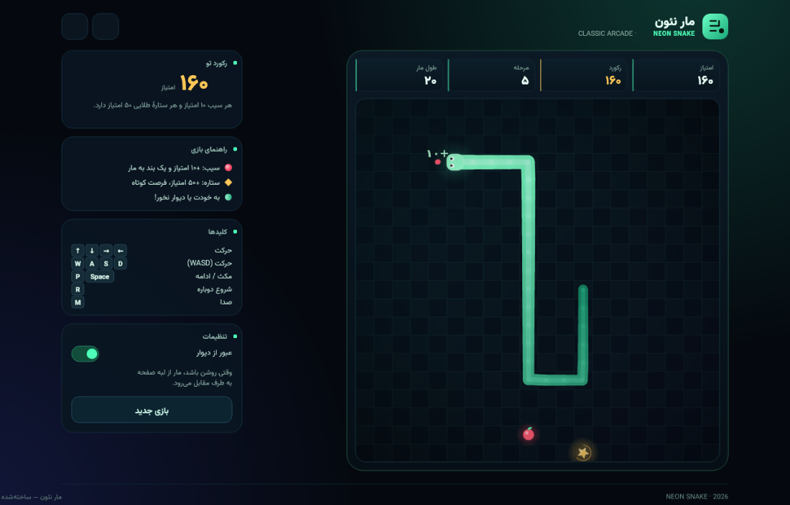

# مار نئون 🐍

یک بازی کلاسیک «مار» (Snake) ساخته‌شده با **HTML، CSS و JavaScript خالص** — بدون هیچ کتابخانه یا فریم‌ورکی. راست‌به‌چپ، فارسی و کاملاً واکنش‌گرا.



<sub>پیش‌نمایش از طرح واقعی رابط کاربری.</sub>

## اجرا

فقط `index.html` را در مرورگر باز کنید. هیچ مرحلهٔ ساخت یا نصبی وجود ندارد.

اگر ترجیح می‌دهید از یک سرور محلی استفاده کنید:

```bash
python3 -m http.server 8000
# سپس در مرورگر: http://localhost:8000
```

## بازی

- **سیب** بخورید: ۱۰+ امتیاز و یک بند به مار اضافه می‌شود.
- **ستارهٔ طلایی** را از دست ندهید: ۵۰+ امتیاز، اما فرصت محدود است (حلقهٔ دور آن زمان باقی‌مانده را نشان می‌دهد).
- هرچه بیشتر بخورید، مار سریع‌تر می‌شود.
- به دیوار یا دُم خودتان نخورید!
- اگر تمام ۴۰۰ خانه را پر کنید، **برنده** می‌شوید.

## کنترل‌ها

| کار | کلید |
|---|---|
| حرکت | `←` `→` `↑` `↓` یا `W` `A` `S` `D` |
| مکث / ادامه | `P` یا `Space` |
| شروع دوباره | `R` |
| قطع / وصل صدا | `M` |
| موبایل | کشیدن انگشت روی صفحه یا دی‌پد لمسی |

## امکانات

- 🎮 سه سطح سختی: آرام، معمولی، سریع (در صفحهٔ شروع و پایان)
- 🏆 ذخیرهٔ رکورد در `localStorage`
- 🔁 گزینهٔ «عبور از دیوار» (wrap-around)
- 🔊 افکت‌های صوتی با Web Audio API (بدون فایل صوتی) + دکمهٔ قطع صدا
- 📱 پشتیبانی کامل از موبایل: دی‌پد لمسی، کشیدن انگشت، جلوگیری از اسکرول صفحه
- ⏸️ مکث خودکار هنگام پنهان‌شدن تب یا از دست دادن فوکوس
- ✨ گرافیک بوم با Canvas: حرکات میان‌فریمی نرم، ذرات، لرزش صفحه، ستارهٔ زمان‌دار
- ♿ دسترس‌پذیری: برچسب‌های `aria`، فوکوس قابل‌مشاهده، احترام به `prefers-reduced-motion`
- 🔤 فونت وزیرمتن به‌صورت محلی (`fonts/`) — بدون وابستگی به CDN
- 🧩 بدون هیچ وابستگی خارجی؛ کل بازی در یک فایل HTML

## ساختار

```
index.html                  ← کل بازی (HTML + CSS + JS)
fonts/Vazirmatn-Variable.woff2
fonts/OFL.txt               ← مجوز فونت (SIL OFL 1.1)
neon-run.html               ← بازی قبلی همین مخزن (مسابقهٔ شبانه)
```

## مجوز

کد بازی آزاد است. فونت وزیرمتن تحت مجوز SIL Open Font License 1.1 منتشر شده است (جزئیات در `fonts/OFL.txt`).
